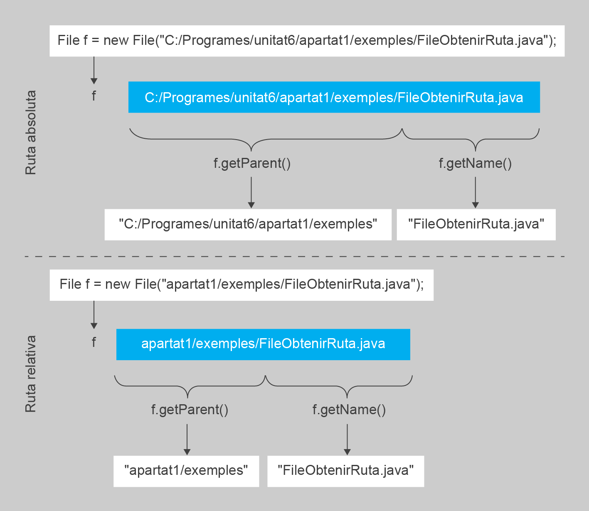

# Gestió de fitxers

En Java, les classes `File` i `Path` són les responsables de les operacions sobre els fitxers. Realitzen les mateixes funcions, però pertanyen a paquets diferents.

### Classe [java.io.File](https://docs.oracle.com/javase/7/docs/api/java/io/File.html?is-external=true)

Des de les primeres versions, Java ha proporcionat el seu propi paquet _java.io_, que conté gairebé totes les classes que podem necessitar per efectuar operacions d'entrada i sortida. La classe File és **una representació abstracta de les rutes de fitxers i directoris**

```java
File file = new File("fitxers/tutorial.txt");
```

Les instàncies de la classe `File` són immutables, és a dir, una vegada creada, la ruta abstracta representada per aquest objecte mai canviarà.

### Classe [java.nio.file.Path](https://docs.oracle.com/javase/7/docs/api/java/nio/file/Path.html)

La classe `Path` forma part de l'actualització NIO2, que es va afegir a Java a partir de la versió 7. Proporciona **una API completament nova per treballar amb E/S**. Com l'antiga classe `File`, la classe `Path` també crea **un objecte que es pot utilitzar per localitzar un fitxer en un sistema de fitxers i totes les operacions** que es poden fer amb la classe `File`

```java
Path path = Paths.get("fitxers/tutorial.txt");
```

En comptes d'utilitzar un constructor com fem amb l'API de `File`, creem una instància de `Path` utilitzant el mètode estàtic [java.nio.file.Paths.get()](https://docs.oracle.com/en/java/javase/11/docs/api/java.base/java/nio/file/Paths.html#get\(java.lang.String,java.lang.String...\))

### Perquè NIO2 API

El paquet _java.io_ es va introduir amb la primera versió del JDK de Java, permetent realitzar accions d'E/S. Des de llavors, molts desenvolupadors han reportat molts inconvenients, funcionalitats que falten i problemes amb algunes de les seves capacitats.

#### Gestió d'errors

El problema més comú és el maneig deficient dels errors. Molts mètodes **no ens proporcionen detalls sobre el problema trobat** o fins i tot no llancen excepcions.

Suposem que tenim un programa senzill que esborra un fitxer:

```java
File file = new File("fitxers/tutorial.txt");
boolean result = file.delete();
```

Aquest codi es compila i s'executa amb èxit sense cap error. Tot i això, trobem la variable `result` amb un valor _fals_, però no coneixem la raó de per què ha fallat l'operació. Potser el fitxer no existeix o el programa no té permisos per esborrar-lo.

Podem reescriure la mateixa funcionalitat amb la nova API NIO2

```java
Path path = Paths.get("fitxers/tutorial.txt");
Files.delete(path);
```

Ara el compilador ens obliga a gestionar una _IOException_. A més, l'excepció llançada conté detalls sobre el seu error que ens indicaran, per exemple, si el fitxer no existeix.

#### Suport de metadades

La classe `File` del paquet _java.io_ té un suport pobre per les metadades, el que pot provocar problemes en diferents plataformes amb operacions d'I/O que requereixen aquesta informació dels fitxers.

Les metadades podrien incloure **permisos**, **propietari** i **atributs de seguretat**. A causa d'això, la classe `File` no admet en absolut els enllaços simbòlics, i el mètode _rename()_ no funciona de manera consistent en diferents plataformes.

#### Escalabilitat i rendiment

Els mètodes de la classe File no escalen bé. Això pot generar problemes en alguns directoris amb una quantitat gran de fitxers. Llistar el contingut d'un directori **pot provocar un bloqueig i problemes en la gestió de memòria**.&#x20;


A causa d'aquests problemes, Oracle va desenvolupar la millorada API NIO2. **Sempre que sigui possible, s'hauria de mirar d'utilitzar el nou paquet **_**java.nio**_ en lloc de les classes antigues.

### Instanciar File i Path

```java
File file = new File("fitxers/tutorial.txt");
Path path = Paths.get("fitxers/tutorial.txt");
```

Aquí construïm un objecte `File` mitjançant el constructor, mentre que obtenim un `Path` utilitzant un mètode estàtic. També podem resoldre rutes complexes utilitzant múltiples arguments.

```java
File file = new File("fitxers", "tutorial.txt");
Path path = Paths.get("fitxers", "tutorial.txt");
```

També podem convertir objectes entre les dues APIs utilitzant els mètodes [toPath()](https://docs.oracle.com/en/java/javase/11/docs/api/java.base/java/io/File.html#toPath\(\)) i [toFile()](https://docs.oracle.com/en/java/javase/11/docs/api/java.base/java/nio/file/Path.html#toFile\(\)):

```java
Path pathFromFile = file.toPath();
File fileFromPath = path.toFile();
```

### Gestionar fitxers i directoris

Ambdues APIs proporcionen mètodes per gestionar fitxers i directoris. Ho demostrarem utilitzant els objectes d'instància creats anteriorment.

Per **crear fitxers**, podem utilitzar els mètodes _createNewFile()_ i _Files.createFile()_:

```java
boolean result = file.createNewFile();
Path newPath = Files.createFile(path);
```

Per **crear un directori**, podem utilitzar els mètodes _mkdir()_ o _Files.createDirectory()_

```java
boolean result = file.mkdir();
File newPath = Files.createDirectory(path);
```

Quan volem **canviar el nom o moure un fitxer**, necessitem crear un altre objecte d'instància i utilitzar _renameTo()_ o _Files.move()_:

```java
boolean result = file.renameTo(new File("fitxers/tutorial2.txt"));
Path newPath = Files.move(path, Paths.get("fitxers/tutorial2.txt"));
```

Per **realitzar una operació d'eliminació**, utilitzem _delete()_ o _Files.delete():_

```java
boolean result = file.delete();
Files.delete(Paths.get(path));
```

Cal destacar que els mètodes originals retornen un indicador amb un resultat establert a _fals_ en cas d'errors. Els mètodes de NIO2 retornen una nova instància de `Path`, excepte per a l'operació d'eliminació, que llança una _IOException_ quan es produeixen errors.

### Llegint Metadades

Podem obtenir informació bàsica sobre els fitxers, com ara els permisos o els tipus. Per fer-ho necessitem una instància de la classe

```java
// java.io API
boolean fileExists = file.exists();
boolean fileIsFile = file.isFile();
boolean fileIsDir = file.isDirectory();
boolean fileReadable = file.canRead();
boolean fileWritable = file.canWrite();
boolean fileExecutable = file.canExecute();
boolean fileHidden = file.isHidden();

// java.nio API
boolean pathExists = Files.exists(path);
boolean pathIsFile = Files.isRegularFile(path);
boolean pathIsDir = Files.isDirectory(path);
boolean pathReadable = Files.isReadable(path);
boolean pathWritable = Files.isWritable(path);
boolean pathExecutable = Files.isExecutable(path);
boolean pathHidden = Files.isHidden(path);
```

Recordeu que amb la classe `File`, algunes de les operacions com _canRead(), canWrite(), isHidden(), i length()_ podrien no funcionar correctament en alguns sistemes operatius, ja que depenen de la plataforma. En canvi, amb la classe `Path` i la classe `Files` de l'API NIO2, obtenim una millor compatibilitat a través de les diferents plataformes.

### Mètodes de ruta de fitxer

Aquestes operacions ens permeten obtenir o manipular informació sobre les rutes dels fitxers o directoris

Per **obtenir la ruta absoluta**, podem utilitzar:

```java
// java.io API
String absolutePathStr = file.getAbsolutePath();

// java.nio API
Path absolutePath = path.toAbsolutePath();
```

També podem **obtenir la ruta fins a l'element o el nom de l'element**, amb els mètodes _getParent()_ o _getName()_.

```java
String pathStr = path.getParent();
String name = path.getName();
```

<figure><figcaption><p>Ruta absoluta / relativa i getParent() / getName()</p></figcaption></figure>

Per obtenir el **llistat de contingut d'un directori:**

```java
// java.io API
String[] list = file.list();
File[] files = file.listFiles();

// java.nio API
DirectoryStream<Path> paths = Files.newDirectoryStream(path);
```

L'API NIO2 retorna el seu propi objecte [_DirectoryStream_](https://docs.oracle.com/en/java/javase/11/docs/api/java.base/java/nio/file/DirectoryStream.html), que implementa la interfície _Iterable_. Podríem recórrer el llistat de subdirectoris de la següent manera:

```java
Path dirPath = Paths.get("/ruta/del/directori");
try (DirectoryStream<Path> directoryStream = Files.newDirectoryStream(dirPath)) {
    for (Path path : directoryStream) {
        // Processar l'element del directori (fitxer o directori) aquí
        System.out.println(path.getFileName());
    }
} catch (IOException e) {
    // Gestionar l'excepció si es produeix un error en llegir el directori
    e.printStackTrace();
}
```
