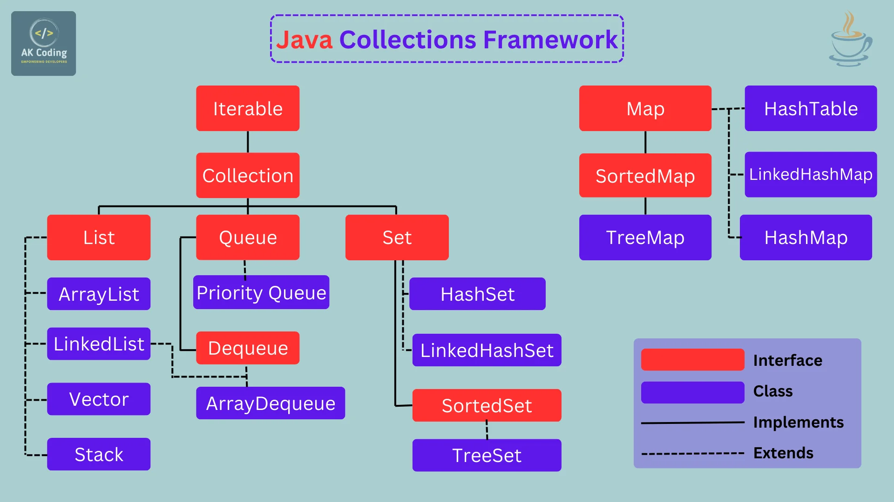

# Col·leccions

A continuació veurem una petita introducció a les Col·leccions en Java. Més endavant del curs les veurem en més detall i treballarem amb més profunditat amb diverses d'elles.

### Què són les Col·leccions?

Les col·leccions en Java són **estructures de dades dinàmiques** que permeten emmagatzemar, gestionar i manipular grups d'objectes. Es troben al paquet **`java.util`** i ofereixen una solució flexible i eficient per treballar amb dades quan no coneixem la mida exacta de la col·lecció en temps de compilació.

#### Avantatges de les Col·leccions

1. **Dinàmiques**: La mida de les col·leccions pot canviar dinàmicament, a diferència dels arrays que tenen una mida fixa.
2. **Interfícies comunes**: Les col·leccions segueixen un conjunt d'interfícies, fet que facilita la reutilització del codi i l'adaptabilitat.
3. **Operacions avançades**: Permeten cercar, ordenar, filtrar, eliminar i altres operacions amb facilitat.

#### Principals Tipus de Col·leccions

Les col·leccions es divideixen en tres grups principals:

1. **Llistes `List`**: Emmagatzemen elements en un ordre específic i permeten elements duplicats. Exemple: `ArrayList`, `LinkedList`.
2. **Conjunts `Set`**: Emmagatzemen elements únics sense un ordre específic. Exemple: `HashSet`, `TreeSet`.
3. **Mapes `Map`**: Emmagatzemen parells clau-valor, on cada clau és única. Exemple: `HashMap`, `TreeMap`.

<figure><figcaption></figcaption></figure>

En aquest document ens centrarem en l'estructura **`ArrayList`**, una implementació de la interfície `List`.

***

## ArrayList

L'**`ArrayList`** és una implementació de la interfície `List` que utilitza un array intern per emmagatzemar els seus elements. A diferència d'un array estàtic, un `ArrayList` pot canviar de mida dinàmicament, afegint o eliminant elements segons calgui.

#### Característiques Principals

* Permet elements duplicats.
* Manté l'ordre d'inserció dels elements.
* Permet accés ràpid als elements mitjançant índexs (com un array).
* No és sincronitzat (no està dissenyat per a l'accés de diferents fils d'execució de forma concurrent, a menys que se sincronitzi manualment).

***

### Com Crear un ArrayList?

Per utilitzar `ArrayList`, primer has d'importar-lo del paquet `java.util`.

#### Exemple:

```java
import java.util.ArrayList;

public class ExempleArrayList {
    public static void main(String[] args) {
        // Crear un ArrayList de Strings
        ArrayList<String> noms = new ArrayList<>();

        // Afegir elements a l'ArrayList
        noms.add("Anna");
        noms.add("Joan");
        noms.add("Maria");

        // Mostrar els elements
        System.out.println("Noms: " + noms);
    }
}
```

### Operacions Principals amb ArrayList

#### 1. **Afegir Elements**

Utilitza el mètode `add` per afegir elements.

```java
ArrayList<String> noms = new ArrayList<>();
noms.add("Anna");
noms.add("Joan");
noms.add(1, "Maria"); // Afegir "Maria" a la posició 1
System.out.println(noms); // Sortida: [Anna, Maria, Joan]
```

***

#### 2. **Accedir a Elements**

Pots accedir als elements mitjançant el mètode `get` i l'índex de l'element.

```java
System.out.println("Primer nom: " + noms.get(0)); // Sortida: Anna
```

***

#### 3. **Modificar un Element**

Utilitza el mètode `set` per canviar un element existent.

```java
noms.set(1, "Laura"); // Substituir "Maria" per "Laura"
System.out.println(noms); // Sortida: [Anna, Laura, Joan]
```

***

#### 4. **Eliminar Elements**

Pots eliminar elements per índex o per valor amb el mètode `remove`.

```java
noms.remove(0); // Eliminar l'element a la posició 0
noms.remove("Joan"); // Eliminar "Joan" per valor
System.out.println(noms); // Sortida: [Laura]
```

***

#### 5. **Comprovar la Presència d'Elements**

Utilitza el mètode `contains` per comprovar si un element existeix.

```java
System.out.println(noms.contains("Laura")); // Sortida: true
System.out.println(noms.contains("Joan")); // Sortida: false
```

***

#### 6. **Recorregut d'un ArrayList**

Hi ha diverses maneres de recórrer un `ArrayList`:

**Amb un bucle `for`:**

```java
for (int i = 0; i < noms.size(); i++) {
    System.out.println("Nom: " + noms.get(i));
}
```

**Amb un bucle `for-each`:**

```java
for (String nom : noms) {
    System.out.println("Nom: " + nom);
}
```

***

#### 7. **Obtenir la Mida**

El mètode `size` retorna el nombre d'elements de l'`ArrayList`.

```java
System.out.println("Mida: " + noms.size()); // Sortida: 1
```

***

### Avantatges i Limitacions d'ArrayList


#### <mark style="background-color:green;">Avantatges</mark>

1. **Flexible**: La mida pot canviar dinàmicament.
2. **Accés Ràpid**: Accés a elements mitjançant índexs.
3. **Compatible**: Suporta moltes operacions definides a la interfície `List`.

#### <mark style="background-color:red;">Limitacions</mark>

1. **Rendiment en Insercions:** Afegir elements al mig o al principi pot ser lent, ja que cal desplaçar els elements.
2. **No Sincronitzat**: No és segur per a ús concurrent sense sincronització.


### Casos d'Ús Comuns


* Gestionar llistes dinàmiques d'elements, com una llista de tasques.
* Manipular dades en aplicacions petites i mitjanes.
* Reemplaçar arrays estàtics quan la mida no és coneguda en temps de compilació.


