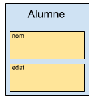

# Tuples

Una **tupla** és una estructura de dades que permet agrupar múltiples elements en una sola entitat. A diferència d'un array, els elements d'una tupla poden ser de **tipus diferents**, cosa que la fa molt útil per representar dades relacionades que no comparteixen el mateix tipus.

Podem imaginar-nos una tupla com un tipus propi. Les tuples ens permeten agrupar diferents tipus de dades sota un nou tipus de dada.

### Què és una tupla?

Una **tupla** és una estructura que conté diversos elements, possiblement de tipus diferents, que pertanyen conceptualment a una mateixa unitat d’informació.

Exemples conceptuals:

* Una persona → _(nom, edat)_
* Un punt 2D → _(x, y)_
* El resultat d’un càlcul → _(valor, missatge)_

En Java, una tupla es representa mitjançant una **classe** amb diversos atributs.

***

## Tuples amb Classes (definició bàsica atributs públics)

La manera més senzilla d’implementar una tupla és crear una classe amb **atributs públics** i accedir-hi directament.\
Aquesta aproximació és adequada per introduir el concepte abans de treballar formalment la POO.

#### Definir una tupla

```java
public class Alumne {
    public String nom;
    public int edat;
}
```

Aquest codi ens permetria **definir** una tupla `Alumne` amb dos elements de diferents tipus. Un nom de tipus `String` i una edat de tipus `int`. Ens hem d'imaginar que defineix la plantilla o l'esbós per poder crear variables de tipus Alumne.

<figure><figcaption></figcaption></figure>

#### Creació d’una instància

```java
//Creació de l'Alumne a
Alumne a = new Alumne();

//Assignació de valors als elements nom i edat de l'Alumne a
a.nom = "Marc";
a.edat = 20;
```

<figure><figcaption></figcaption></figure>


Tal com hem vist amb els arrays o taules, la paraula `new` crea una estructura per guardar la informació a la part de [memòria dinàmia o heap](#user-content-fn-1)[^1] i ens retorna la seva referència (la direcció on la trobarem)


<figure><figcaption></figcaption></figure>

#### Accés directe als valors

```java
System.out.println(a.nom);   // "Marc"
System.out.println(a.edat);  // 20
```

Aquesta aproximació és **simple** i **útil per introduir el concepte de tupla**, però té inconvenients que veurem més endavant.

***

## Tupla amb encapsulació

Això és només una **introducció**. A l’apartat de POO veurem aquesta pràctica amb més profunditat.

```java
public class Alumne {
    private String nom;
    private int edat;

    public Alumne(String nom, int edat) {
        this.nom = nom;
        this.edat = edat;
    }

    public String getNom() {
        return nom;
    }

    public int getEdat() {
        return edat;
    }
}
```

Accés:

```java
Alumne a = new Alumne("Marc", 20);

System.out.println(a.getNom());
System.out.println(a.getEdat());
```

> ✔️ **Aquesta és la versió recomanada**, però només s’introdueix aquí per comparació.\
> Els detalls es treballaran més endavant quan expliquem _encapsulació_, _getters_, _setters_, i bones pràctiques de POO.

## Per què no es recomana fer servir atributs públics?

Tot i que és la manera més ràpida d'introduir les tuples, **no respecta l'encapsulació**, un dels principis fonamentals de la Programació Orientada a Objectes.

Amb atributs públics:

* No podem controlar els valors que s’hi assignen
* No podem validar dades
* No podem impedir modificacions incorrectes
* No es pot garantir la coherència interna de l'objecte

Per això, a POO acostumem a fer que els atributs siguin **privats** i exposem **mètodes d’accés**.

***

## Alternatives existents

En projectes més avançats és habitual utilitzar estructures ja definides:

* **Classes genèriques pròpies** com `Pair`, `Triple`
* **Llibreries externes** com:
  * _Apache Commons Lang_ (`Pair`, `Triple`)
  * _Vavr_ (`Tuple2`, `Tuple3`, ...)

> En aquest curs ens centrarem en **classes personalitzades**, que és la base del model orientat a objecte

[^1]: És la regió de memòria dinàmica on s'emmagatzemen els objectes i les dades que necessiten una durada més llarga, més enllà de l'àmbit d'un mètode. Aquesta és gestionada per la JVM
