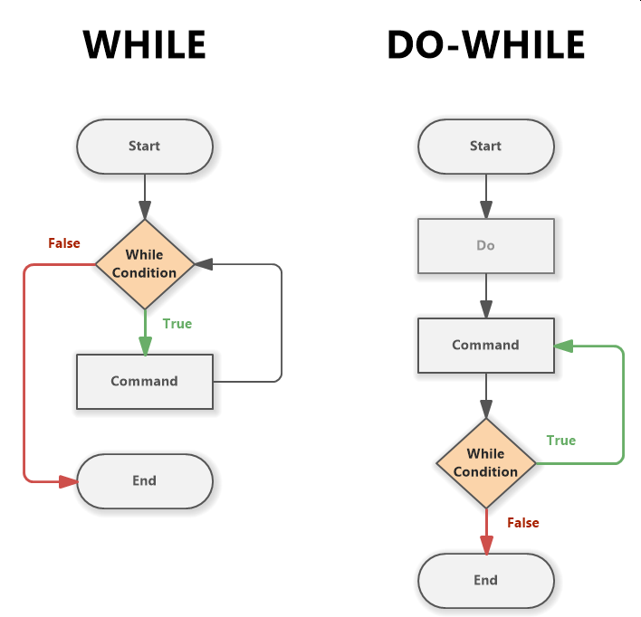

# Estructures repetitives

Les estructures repetitives permeten executar un bloc de codi diverses vegades fins que es compleixi una condició o es realitzi un nombre determinat d'iteracions. En Java, les estructures repetitives principals són `while`, `do-while`, i `for`.

### Bucle `while`

#### Descripció

El bucle `while` repeteix un bloc d'instruccions mentre una condició sigui certa. La condició es comprova **abans** de cada iteració, la qual cosa significa que si la condició és falsa des del principi, el bloc no s'executarà ni una vegada.

#### Sintaxi

```java
while (condicio) {
    // Bloc d'instruccions mentre la condició sigui certa
}
```

#### Exemple

Aquest exemple mostra l'ús d'un bucle `while` per imprimir els números de l'1 al 5.

```java
int i = 1;

while (i <= 5) {
    System.out.println("Iteració " + i);
    i++;
}
```

**Sortida:**

```
Iteració 1
Iteració 2
Iteració 3
Iteració 4
Iteració 5
```

### Bucle `do-while`

#### Descripció

El bucle `do-while` és similar al `while`, però amb una diferència important: la condició es comprova **després** de cada iteració. Això assegura que el bloc d'instruccions s'executi almenys una vegada, fins i tot si la condició és falsa des del principi.

#### Sintaxi

```java
do {
    // Bloc d'instruccions
} while (condicio);
```

#### Exemple

Aquest exemple utilitza un bucle `do-while` per imprimir els números de l'1 al 5.

```java
int i = 1;

do {
    System.out.println("Iteració " + i);
    i++;
} while (i <= 5);
```

**Sortida:**

```
Iteració 1
Iteració 2
Iteració 3
Iteració 4
Iteració 5
```

A continuació podem veure el diagrama de flux de les dues estructures i observar com en un cas la condició s'avalua abans i en l'altre després d'executar el bloc d'instruccions repetitives.

<figure><figcaption><p>Diagrama de flux While i Do-While</p></figcaption></figure>

### Bucle `for`

#### Descripció

El bucle `for` és ideal per a situacions en què sabem per endavant el nombre d'iteracions que es volen realitzar. Consta de tres parts dins dels parèntesis: **inicialització**, **condició** i **actualització**. Cada part s'executa en el seu ordre específic:

1. **Inicialització**: S'executa una vegada al principi.
2. **Condició**: Es comprova abans de cada iteració; si és falsa, el bucle s'atura.
3. **Actualització**: S'executa després de cada iteració.

#### Sintaxi

```java
for (inicialitzacio; condicio; actualitzacio) {
    // Bloc d'instruccions
}
```

#### Exemple

Aquest exemple utilitza un bucle `for` per imprimir els números de l'1 al 5.

```java
for (int i = 1; i <= 5; i++) {
    System.out.println("Iteració " + i);
}
```

**Sortida:**

```
Iteració 1
Iteració 2
Iteració 3
Iteració 4
Iteració 5
```

### Resum de les estructures repetitives

<table data-full-width="true"><thead><tr><th>Estructura</th><th>Comprovació de la condició</th><th>S'executa almenys una vegada?</th><th>Cas d'ús</th></tr></thead><tbody><tr><td><code>while</code></td><td>Abans de cada iteració</td><td>No</td><td>Quan no sabem el nombre d'iteracions, depenent d'una condició</td></tr><tr><td><code>do-while</code></td><td>Després de cada iteració</td><td>Sí</td><td>Quan volem assegurar-nos que el codi s'executa almenys una vegada</td></tr><tr><td><code>for</code></td><td>Abans de cada iteració</td><td>No</td><td>Quan coneixem el nombre d'iteracions per endavant</td></tr></tbody></table>
