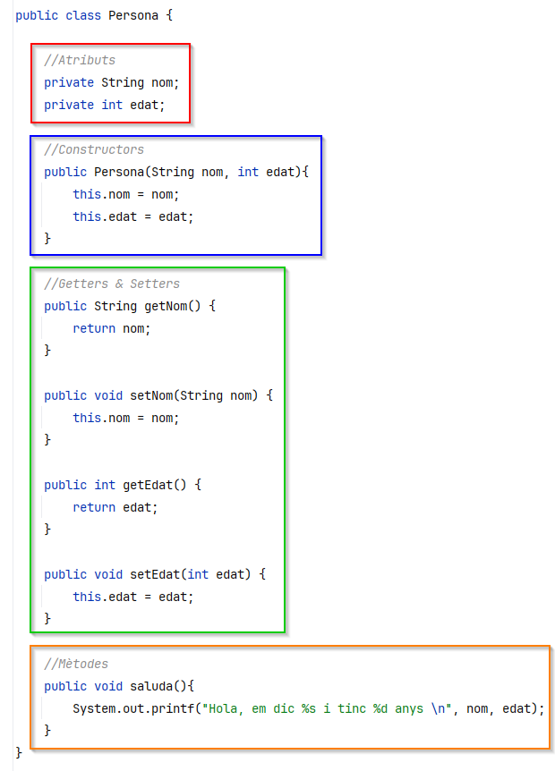

# Introducció a la programació

## 0. ÍNDEX

1. [**Introducció a la programació**](introduccio-a-la-programacio.md#id-1.-introduccio-a-la-programacio)
   * Concepte de programa
   * Algorismes
   * Llenguatges de programació i IDE
   * Errors
2. [**Components d'un sistema informàtic**](introduccio-a-la-programacio.md#id-2.-components-dun-sistema-informatic)
   * Processador
   * Memòria
   * Entrada/sortida
3. [**Algorismes**](introduccio-a-la-programacio.md#id-3.-algorismes)
   * Concepte i definició
   * Classificació: seqüencial, iteratiu i condicional
   * Representació: Diagrames de flux i pseudocodi
4. [**Llenguatges de programació**](introduccio-a-la-programacio.md#id-4.-llenguatges-de-programacio)
   * Llenguatge màquina i assemblador
   * Llenguatges d'alt i baix nivell
   * Llenguatges compilats i interpretats
5. [**Tipus de programació**](introduccio-a-la-programacio.md#id-5.-tipus-de-programacio)
   * Programació estructurada
   * Programació modular
   * Programació orientada a objectes

***

## 1. Introducció a la programació

* **Concepte de programa**: És un conjunt d'ordres o instruccions que es processen de manera seqüencial. Exemples de programes són els de les rentadores o robots de cuina, que executen tasques específiques de manera ordenada.
*   **Algorismes**: Són mètodes per resoldre problemes amb un seguit de passos finits. Un exemple senzill seria un algorisme per fer una truita, amb una seqüència de passos.&#x20;

    Podem imaginar-nos com un manual d'instruccions. Si estàs muntant un moble d'IKEA, el manual et diu com muntar-lo pas a pas.&#x20;

    * Un algorisme per escalfar l'aigua seria:
      1. Agafar una olla.
      2. Posar-hi aigua.
      3. Encendre el foc.
      4. Esperar fins que bulli.
* **Llenguatges de programació**: El llenguatge de programació és el conjunt de normes sintàctiques i semàntiques que s'han de complir perquè l'ordinador pugui interpretar què ha de fer. &#x20;
* **Errors:**
  * **Errors de compilació**: Violacions de la sintaxi del llenguatge.
  * **Errors d'execució**: Succeeixen quan el programa troba operacions impossibles, com dividir per zero.
  * **Errors de lògica**: El programa produeix resultats incorrectes.
* **IDE (Integrated Development Environment):** O Entorn de Desenvolupament Integrat, és el programa informàtic que ajuda i assisteix en la creació de nous programes.

<figure><figcaption><p>Visual Studio Code</p></figcaption></figure>

## 2. Components d'un sistema informàtic

* **Processador**: És el centre de control de l'ordinador, que manipula les dades a partir d'instruccions binàries.
* **Memòria**: Emmagatzema dades de manera temporal durant l'execució d'un programa, principalment a la RAM.
* **Entrada/sortida**: Permet interactuar amb l'exterior, ja sigui a través de teclat, pantalla o altres dispositius.

## 3. Algorismes

* **Concepte i definició**: Un algorisme és un mètode per resoldre un problema en un nombre finit de passos. Ha de ser precís i sense ambigüitats.
* **Classificació**:
  * **Seqüencial**: S'executen les ordres en l'ordre escrit.
  * **Iteratiu**: Repeteixen un conjunt d'instruccions mentre es compleix una condició.
  * **Condicional**: L'execució varia en funció de certes condicions.
* **Representació**:
  * **Diagrames de flux**: Representació gràfica dels passos d'un algorisme.

<figure><figcaption></figcaption></figure>

<figure><figcaption></figcaption></figure>

* **Pseudocodi**: Representació textual, amb paraules clau i estructures pròpies de programació.


## 4. Llenguatges de programació

Un **llenguatge de programació** és un conjunt d'instruccions i normes que els programadors utilitzen per comunicar-se amb un ordinador. Permet que els humans escriguin algorismes i ordres en un format comprensible per l'ordinador, que després es tradueix a codi màquina (binari) que el processador pot executar. Podem classificar els llenguatges segons dues principals característiques, la complexitat o el tipus d'execució:

*   **Llenguatges d'alt i baix nivell**:

    * **Baix nivell**: Treballen molt pròxims al maquinari (ex: llenguatge màquina. assemblador...).

    <figure><figcaption></figcaption></figure>

    * **Alt nivell**: Llenguatges que permeten més abstracció del maquinari, més propers a com escrivim els humans. Alguns exemples poden ser Java o Python.

```java
public class HelloWorld {
    public static void main(String[] args) {
        System.out.println("Hola, món!");
    }
}
```

```python
nom = "Marc"
print(f"Hola, {nom}!")
```

* **Llenguatges compilats i interpretats**:
  * **Compilats**: Traduïts a codi màquina abans de ser executats.
  * **Interpretats**: Executats línia per línia per un intèrpret.

## 5. Tipus de programació

* **Programació estructurada**: Es basa en la utilització d'estructures de control seqüencials, alternatives (condicionals) i iteratives (bucles). No permet l'ús de transferències incondicionals com el `goto`.
* **Programació modular**: Divideix el programa en mòduls independents, cada un responsable d'una part del programa.
* **Programació orientada a objectes**: Treballa amb objectes que encapsulen dades i mètodes, facilitant la reutilització i l'abstracció.

***
