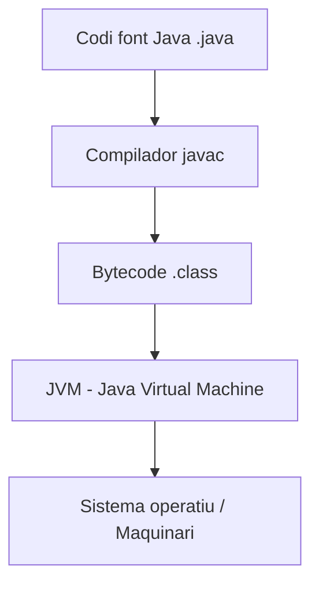
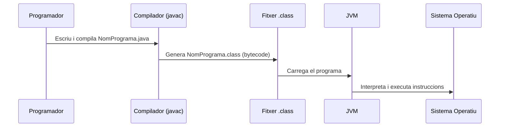

# Estructura d’un programa en Java

### Què és Java?

* Java és un **llenguatge de programació orientat a objectes** creat per _Sun Microsystems_ (1995).
* La seva principal aportació és ser un **llenguatge híbrid**:
  * Té la **portabilitat** dels llenguatges interpretats.
  * Manté l’**eficiència** dels llenguatges compilats.
* Es va dissenyar amb l’objectiu de ser segur, senzill i especialment útil en entorns distribuïts com **Internet**.

***

### El lema de Java: _WORA_

Java es va popularitzar amb l’eslògan:

> **Write Once, Run Anywhere (WORA)**\
> Escriu el codi un cop i executa’l a qualsevol plataforma.

Això és possible gràcies a la **Java Virtual Machine (JVM)**, que permet que el mateix programa es pugui executar en diferents sistemes operatius sense recompilar.



***

### Components principals de Java

Per entendre com funciona, és important distingir tres peces clau:

#### **JVM (Java Virtual Machine)**

* Interpreta i executa el **bytecode** generat pel compilador de Java.
* Fa de capa intermèdia entre el programa i el sistema operatiu.
* És el que garanteix la portabilitat.

**JRE (Java Runtime Environment)**

* Inclou la **JVM** i les **llibreries bàsiques de Java** necessàries per executar aplicacions.
* Serveix per a **executar programes Java**, però no per desenvolupar-los.

**JDK (Java Development Kit)**

* Inclou el **JRE**, el compilador (`javac`) i eines de desenvolupament.
* És el que necessitem per a **programar i compilar en Java**.

***

### Funcionament de Java pas a pas

1. El programador escriu un fitxer `NomPrograma.java`.
2. El compilador de Java (`javac`) tradueix aquest fitxer a **bytecode** (`NomPrograma.class`).
3. El bytecode s’executa a la **JVM**, que és específica de cada sistema operatiu però entén el mateix bytecode.
4. La JVM converteix el bytecode en instruccions natives que pot entendre la màquina.



***

### Avantatges de Java

* **Portabilitat**: el mateix programa pot executar-se a Windows, Linux o macOS.
* **Orientat a objectes**: facilita la reutilització i manteniment del codi.
* **Seguretat**: la JVM aïlla el programa de l’accés directe al maquinari.
* **Gran ecosistema**: llibreries, frameworks i comunitat molt extensa.

***

### Resum gràfic

```
       ┌───────────────┐
       │   Codi font   │   (.java)
       └───────┬───────┘
               │ Compilació (javac)
               ▼
       ┌───────────────┐
       │   Bytecode    │   (.class)
       └───────┬───────┘
               │ Execució
               ▼
       ┌───────────────┐
       │     JVM       │
       └───────┬───────┘
               ▼
       ┌───────────────┐
       │   Sistema OS  │
       └───────────────┘
```

En Java, un programa està format per un o més fitxers que contenen classes. Cada classe pot tenir un punt d'entrada definit pel mètode `main()`. Aquest mètode és el primer que s'executa quan s'inicia el programa. L'estructura bàsica és:


```java
import java.util.*; // Llibreries que es poden importar si cal

class MevaClasse { // Definició d'una classe

    public static void main(String[] args) { // Mètode principal (punt d'entrada)
    
        // Aquí van les instruccions del programa
        // ...
        // ...
        
        System.out.println("Hello World!"); // Printa Hello World! per consola
    }
    
    // Aquí poden anar-hi més subprogrames definits per l'usuari (accions o funcions)
}
```


Aquest codi defineix una classe anomenada `MevaClasse` amb el mètode `main` que és el punt d'entrada del programa. Això ens permetrà començar a provar les nostres primeres línies de codi.

### Comentaris

El codi font d'un programa no només conté instruccions per ser executades, també inclouen els comentaris. Aquests permeten als programadors documentar el codi. Aquestes línies no s'executen, només serveixen per afegir explicacions o documentació dins del codi.

1. Comentaris de línia `//`
   * Per fer comentaris breus que expliquen una sola línia o instrucció de codi.
   * És útil per documentar petites accions o passos dins d'un mètode.
2. Comentaris de bloc `/*  */`
   * Per fer comentaris més extensos que expliquen seccions completes de codi.
   * Ideal per descriure mètodes, funcions o blocs de lògica complexa.
3. Comentaris de documentació `/** */`
   * Per documentar classes, mètodes o atributs de manera detallada.
   * Permet generar documentació HTML automàtica mitjançant eines com **Javadoc**.
   * Pot incloure etiquetes especials com `@param` o `@return` per descriure els paràmetres i els valors de retorn.
