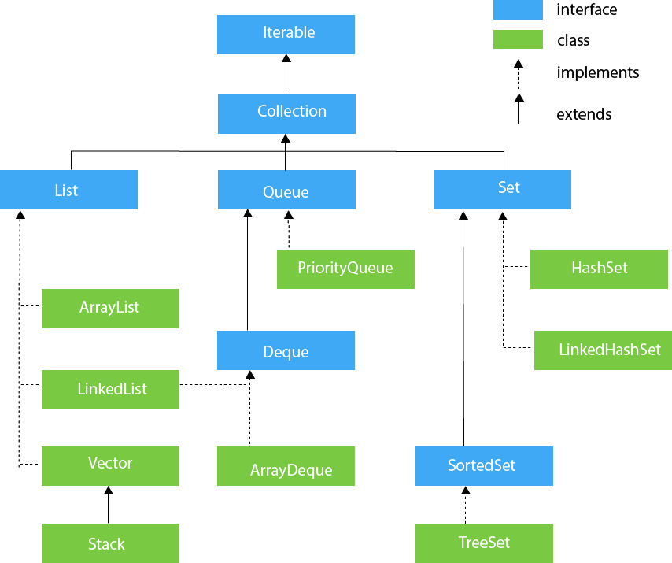

# Framework

El framework de col.leccions de Java permet emmagatzemar, obtenir, manipular i comunicar dades agregades. Conté els següents elements:

* **Interfícies**: són tipus de dades abstractes que representen col·leccions. Les interfícies permeten manipular les col·leccions independentment dels detalls de la seva representació. En llenguatges orientats a objectes, les interfícies formen generalment una jerarquia.
* **Implementacions**: Són les implementacions concretes de les interfícies de recollida. En essència, són estructures de dades reutilitzables.
* **Algorismes**: Són els mètodes que realitzen càlculs útils, com cercar i ordenar, en objectes que implementen interfícies de col·lecció. Es diu que els algoritmes són polimorfs: és a dir, es pot utilitzar el mateix mètode en moltes implementacions diferents de la interfície de col·lecció adequada. En essència, els algoritmes són funcionalitats reutilitzables.

A continuació es poden veure les **interfícies** principals.

<figure><figcaption><p><a href="https://www.javatpoint.com/collections-in-java">Hierarchy of Collection Framework (javaTpoint)</a></p></figcaption></figure>

* **Collection** : l’arrel de la jerarquia de col·leccions. Una col·lecció representa un grup d'objectes coneguts com els seus elements. La interfície de col·lecció és el denominador menys comú que totes les col·leccions implementen i s'utilitza per passar col·leccions i manipular-les quan es desitgi la màxima generalitat. Alguns tipus de col·leccions permeten duplicar elements, i d’altres no. Alguns estan ordenats i d’altres no ordenats. La plataforma Java no proporciona cap implementació directa d'aquesta interfície, però proporciona implementacions de subinterfícies més específiques, com ara Set and List.
* **Set** : una col·lecció que no pot contenir elements duplicats. Aquesta interfície modela l’abstracció de conjunts matemàtics i s’utilitza per representar conjunts, com ara les cartes que contenen una mà de pòquer, els cursos que configuren el programa d’un estudiant o els processos que s’executen en una màquina. Té una versió ordenada, **SortedSet** (per valor ascendent).
* **List** : una col·lecció ordenada (de vegades anomenada seqüència). Les llistes poden contenir elements duplicats. L’usuari d’una llista generalment té un control precís sobre on s’insereix cada element a la llista i pot accedir a elements mitjançant l’índex d’enters (posició). Si heu utilitzat Vector, coneixeu el sabor general de la llista. Consulteu també la secció La interfície de llista.
* **Queue** : una col·lecció usada per contenir diversos elements abans del processament. A més de les operacions bàsiques de recollida, una cua proporciona operacions addicionals d'inserció, extracció i inspecció. Les cues normalment, però no necessàriament, ordenen elements de manera FIFO (first-in, first-out).
* **Deque** : és una cua de doble final, i per tant permet inserir, extraure i inspeccionar elements als dos punts. Deques es pot utilitzar tant com FIFO (primer ingrés, primer sortida) com LIFO (darrera entrada, primer sortida).
* **Map** : un objecte que assigna mapes de valors. Un mapa no pot contenir claus duplicades; cada tecla pot associar com a màxim un valor. Si heu utilitzat Hashtable, ja coneixeu els fonaments bàsics de Map. Consulteu també la secció La interfície del mapa. Té una versió ordenada, **SortedMap** (per clau ascendent).

Les col·leccions utilitzen el concepte de **genèrics** de Java. Bàsicament, permet definir el tipus de l'element de les col·leccions com un paràmetre. Per exemple, per a la collecció de tipus List, la definició a la documentació de Java és:

```java
Interface List<E>
```

Això significa que List és una llista d'elements (E) de tipus parametritzable. Per tant, podem utilitzar List per qualsevol classe (no tipus primitiu).
