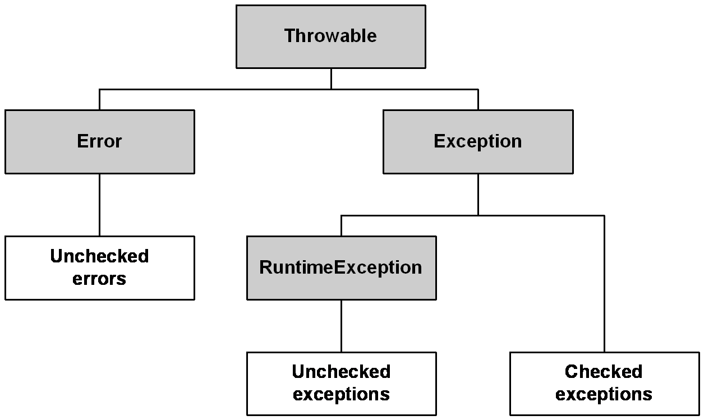

# Tipus d'excepcions

* **Checked**: són les excepcions que cal gestionar obligatòriament. Es produeixen per condicions fora de l'abast del programa. Exemple: `FileNotFoundException`. Hi ha dues formes de gestionar-les:
  * una sentència "**try/catch**"que gestioni l'excepció

```java
try {
    // codi que llença una excepció
} catch (SomeException e) {
    // codi que gestiona l'excepció 
}
```

* que el mètode especifiqui que pot llençar aquesta excepció (**throws**)

```java
public void metode() throws SomeException {
    // codi que llença una excepció
}
```

* **Unchecked**: són les excepcions que no cal gestionar. Habitualment, reflecteixen errors de lògica.
  * **Errors** (tipus `Error`): són esdeveniments excepcionals (del tipus Error) i habitualment irrecuperables. Exemple: `OutOfMemoryError`.
  * Excepcions de l'entorn d'execució (tipus `RuntimeException`): són excepcionals i associats a l'aplicació. Exemple: `NullPointerException`.

<figure><figcaption><p>Herència de la classe Throwable</p></figcaption></figure>
