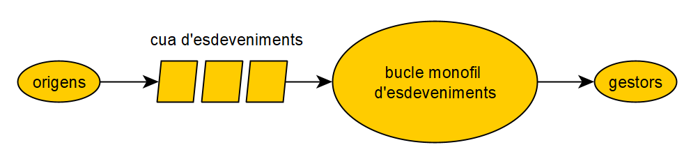

# Concurrència

Les aplicacions GUI (interfície gràfica d'usuari) de Java (inclosa JavaFX) són inherentment multifil. Diversos fils realitzen tasques diferents per mantenir la interfície d'usuari en sincronització amb les accions de l'usuari. JavaFX utilitza **un únic fil**, anomenat **JavaFX Application Thread**, per processar tots els esdeveniments de la interfície d'usuari. Els nodes que representen la interfície d'usuari d'una gràfica d'escena no són segurs. El disseny de nodes que no són segurs per a fils presenta avantatges i inconvenients. Són més ràpids, ja que no hi ha cap sincronització. L’inconvenient és que s’han d’accedir des d’un mateix fil per evitar estar en un estat il·legal. JavaFX posa una restricció a la qual s’ha d’accedir a un gràfic d’escena en directe des d’un únic fil, el fil d’aplicacions JavaFX. Aquesta restricció imposa indirectament una altra restricció que un esdeveniment d’UI **no ha de processar una tasca de llarga durada**, ja que farà que l’aplicació no respongui.

<figure><figcaption></figcaption></figure>

Si un altre fil vol modificar la GUI, cal que utilitzi la següent construcció per afegir la tasca a la cua d'esdeveniments:

```java

Platform.runLater(new Runnable() {
    @Override
    public void run() {
        // acció que es vol realitzar
    }
});

```
