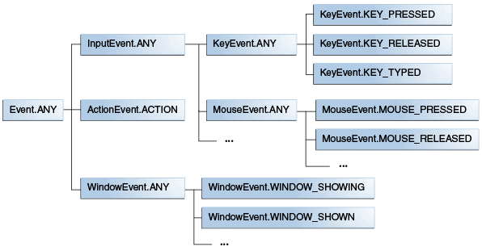

# Gestió d'esdeveniments

Els esdeveniments notifiquen a l'aplicació de les accions de l'usuari. Els esdeveniments són subclasses d'`Event`. Per exemple, `MouseEvent`, `KeyEvent`, `DragEvent` o `WindowEvent`.

Partim d'un exemple: un clic del ratolí a un botó. Llavors, un esdeveniment es compon de:

* Destí: el node on succeïx l'esdeveniment. Pot ser una finestra, una escena o un node. En l'exemple, el botó.
* Origen: el lloc on es genera l'esdeveniment. En l'exemple, el ratolí.
* Tipus: el tipus. En l'exemple, clicar el ratolí.

<figure><figcaption></figcaption></figure>

## Processament d'esdeveniments

El processament de l'esdeveniment és el següent:

1. **Selecció** del destí:
   * Si és un esdeveniment de tecles (keys), l'element que tingui el focus.
   * Si és un esdeveniment de mouse, l'element a sota. Si hi ha més d'un, el que estigui a sobre.
2. **Construcció** de l'encaminament: en funció de la jerarquia dels nodes. És el camí des del stage fins arribar al node destí.
3. **Captura** (camí des del stage fins al destí). Aquí **no es criden els gestors, però sí els filtres**, que poden consumir l'esdeveniment amb `event.consume()` i finalitzar la captura.
4. **Retorn** (bombolla): pel camí de tornada cap al stage. Aquí **es criden els gestors**. Si el gestor d'un node no consumeix l'esdeveniment, un gestor del node pare pot fer-ho, permetent gestors comuns per diversos nodes fill.

## Classes anònimes i expressions Lambda

Exemple de gestió d'un esdeveniment d'un botó (control de tipus `Button`):

```java
button.setOnAction(new EventHandler<ActionEvent>() {
    @Override
    public void handle(ActionEvent event) {
        System.out.println("Botó clicat!");
    } 
});
```

Aquest codi utilitza classes anònimes.

També podem utilitzar expressions Lambda, ja que els gestors d'esdeveniments són **interfícies funcionals** (un sol mètode abstracte):

```java
buttn.setOnAction(
    event -> System.out.println("Botó clicat!")
);
```

## Mètodes per afegir gestors i filtres

Els **filtres** permeten gestionar el processament de l'esdeveniment i consumir-lo, si cal.

```java
<T extends Event> void addEventFilter​(
    EventType<T> eventType, EventHandler<? super T> eventFilter)
<T extends Event> void removeEventFilter​(
    EventType<T> eventType, EventHandler<? super T> eventFilter)
```

Els **gestors (handlers)** permeten a les aplicacions prendre accions en funció del seu tipus, origen i destí.

```java
<T extends Event> void addEventHandler​(
    EventType<T> eventType, EventHandler<? super T> eventHandler)
<T extends Event> void removeEventHandler​(
    EventType<T> eventType, EventHandler<? super T> eventHandler)
```

Per als gestors tenim els mètodes generals que hem vist i els **mètodes de conveniència** `.setXXX()` que faciliten escriure el codi sense haver d'indicar el tipus d'esdeveniment. Tots els setters treballen amb un sol handler, mentre que l'add/remove permet afegir diversos handlers al mateix esdeveniment.

```java
button.addEventHandler(MouseEvent.MOUSE_CLICKED, mouseHandler);
button.setEventHandler(MouseEvent.MOUSE_CLICKED, mouseHandler);
button.setOnMouseClicked(mouseHandler);
button.setOnAction(actionHandler);
```

Aquests són alguns dels mètodes de conveniència disponibles:

* General: `setOnAction`
* Ratolí: `setOnMouseClicked, setOnMouseEntered, setOnMouseExited, setOnMousePressed`
* Teclat: `setOnKeyTyped, setOnKeyPressed, setOnKeyReleased`

En general, `setOnAction` funciona per tots els controls. Hi ha casos especials, com per exemple si volem atendre el canvi de qualsevol contingut d'un TextField. Es pot utilitzar:

* `TextField.textProperty().addListener(ChangeListener listener)`

I per escoltar un índex numèric sobre un `ChoiceBox`:

* `ChoiceBox.getSelectionModel().selectedIndexProperty().addListener(ChangeListener listener)`

Pots veure la [llista de controls i com utilitzar-los](https://docs.oracle.com/javase/8/javafx/user-interface-tutorial/ui\_controls.htm).
