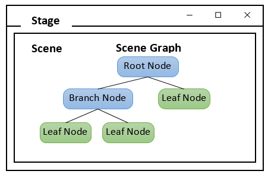

# JavaFX

Aquest apartat utilitzarà **JavaFX** per a la creació d'interfícies gràfiques. Aquesta plataforma substitueix Swing com a llibreria GUI de Java, i permet desenvolupar aplicacions d'escriptori.

Aquests són els aspectes principals dels components gràfics de JavaFX:

* Un programa JavaFX consisteix a una classe que estén la classe abstracta `javafx.application.Application`.
* El contenidor de màxim nivell màxim és `javafx.stage.Stage`. Es correspon amb una finestra.
* Els components visuals (nodes) estan continguts dins d'un scene: `javafx.scene.Scene`.
* Una aplicació pot contenir diverses scenes, però només una es pot mostrar al stage.
* Un scene conté un graf jeràrquic de nodes: `javafx.scene.Node`.

Per tant, per construir la UI cal:

1. Preparar un graf de scene.
2. Construir un scene amb el node arrel del graf.
3. Configurar el stage amb aquest scene.

<figure><figcaption>
JavaFx
</figcaption></figure>
