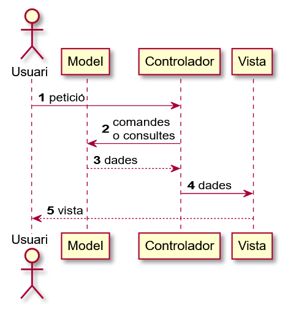
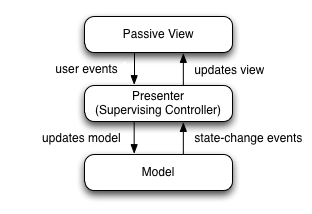
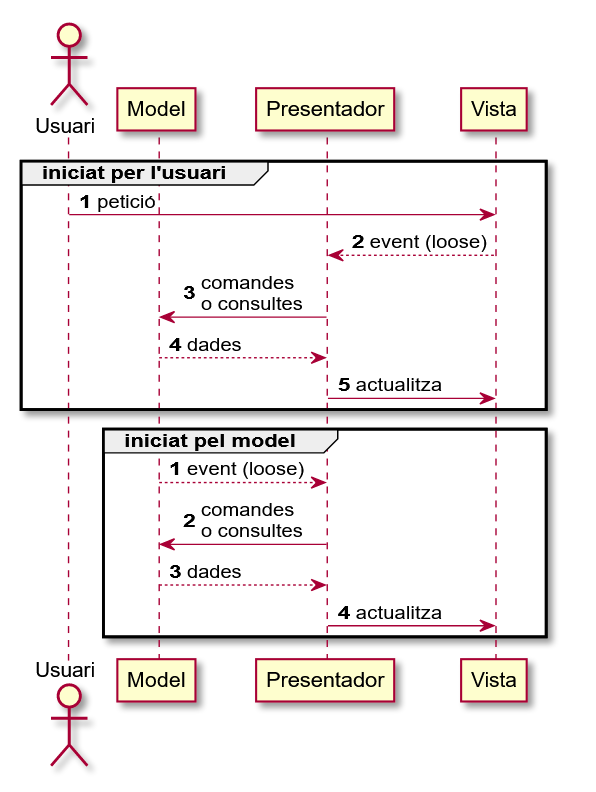

# Patró de disseny UI

Un patró de disseny associat típicament al desenvolupament d'interfícies d'usuari (UI) és el model-vista-controlador (**MVC**). S'utilitza habitualment a l'entorn web, i la seva implementació pot variar. El següent diagrama és una opció.

<figure><figcaption></figcaption></figure>

Una particularització d'aquest patró és el model-vista-presentador (**MVP**), on el presentador és un controlador que fa d'intermediari entre la vista (passiva) i el model. Està més associat amb aplicacions natives com, per exemple, JavaFX.

Aquestes són les responsabilitats de cada component del patró:

* **Vista**: genera la part visual de l'aplicació. Envia esdeveniments cap al presentador, i rep peticions del presentador per actualitzar-se.
* **Presentador**: s'encarrega de mitjançar entre la vista i el model. No conté cap codi associat a la UI.
* **Model**: part del patró que s'encarrega d'accedir a funcionalitats o dades a una llibreria independent, que no té cap relació amb la presentació visual.

<figure><figcaption></figcaption></figure>

<figure><figcaption></figcaption></figure>

## Encapsulació al patró MVP

En aquest esquema, és important **encapsular** correctament. Si es fa bé, tant la vista com el model serien substituïbles. Això només es pot aconseguir si les tres parts es relacionen mitjançant abstraccions d'un contracte, les quals poden ser implementades mitjançant una interfície Java.

Si fem bé l'encapsulació podem testar tant el presentador com el model. L'aproximació és utilitzar una [vista passiva](https://martinfowler.com/eaaDev/PassiveScreen.html): la vista mai es comunica amb el model, i és el presentador qui gestiona els seus esdeveniments i l'actualitza. Per fer el testing general podem utilitzar un [doble de proves](https://martinfowler.com/bliki/TestDouble.html) de la vista.

Així es defineixen i relacionen les parts:

* La **vista** envia esdeveniments al seu únic observador, el **presentador**. Té mètodes que permeten al presentador actualitzar-la, i és agnòstic d'aquest. Només la vista conté classes de la llibreria visual (JavaFX).
* El **presentador** té una instància de la **vista** (per enviar-li actualitzacions de la part visual) i una instància del **model** (per enviar comandes o consultes).
* El **model** envia esdeveniments al **presentador**, el seu observador. El model és agnòstic respecte del funcionament del presentador i tampoc coneix cap aspecte visual.

A continuació es mostra una plantilla d'interfícies per a aquest patró.

```java

interface View {
    void setListener(ViewListener l); // permet registrar el presenter
    // cal afegir comandes des del presentador
}
interface ViewListener {
    // cal afegir mètodes que escolten esdeveniments de la view
}
interface Presenter extends ViewListener, ModelListener {
    void start(); // mètode d'inici de l'aplicació
    void stop(); // mètode de fi de l'aplicació
}
interface Model {    
    void setListener(ModelListener l); // permet registrar el presenter
    // cal afegir els comandes i queries del presenter
}
interface ModelListener {
    // cal afegir un mètode per cada esdeveniment generat pel model
}

```
