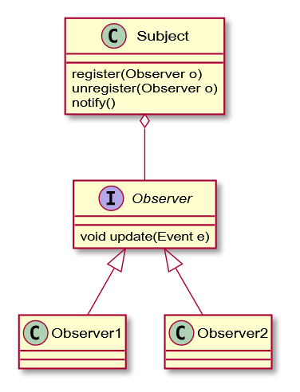
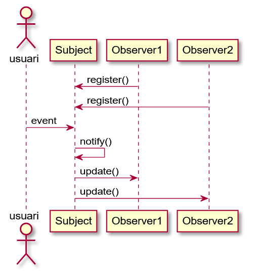

# Programació orientada a esdeveniments

## Bucle d'esdeveniments

La programació d'interfícies d'usuari es fa mitjançant **esdeveniments**. Aquesta és la seqüència:

1. L'usuari interactua amb el GUI
2. Es produeix un esdeveniment
3. En resposta, una peça de codi s'executa
4. S'actualitza l'aparença del GUI

Aquestes operacions es produeixen dins del bucle d'esdeveniments ([**event loop**](https://en.wikipedia.org/wiki/Event\_loop)). Els esdeveniments s'afegeixen a una mena de cua, i es van satisfent o gestionant amb el codi que el programador ha decidit. Aquest bucle és **un sol fil**, i per tant no es poden realitzar operacions massa llargues, ja que es bloquejaria el GUI i deixaria de respondre.

El codi equivalent seria:

```java
do {
    e = getNextEvent();
    processEvent(e);
} while (e != quit);
```

El flux d'un programa amb GUI no està predeterminat: depèn dels esdeveniments que es produeixin. En contrast, les aplicacions que es recolzen en algorismes esperen unes dades d'entrada en un ordre i temps predeterminat.

## Patró observador

El **patró** principal que s'utilitza a les interfícies gràfiques és el de l'**observador**. En aquest patró intervenen una parella subjecte/observador. El funcionament bàsic és que tenim un subjecte que genera esdeveniments i un o més observadors que els escolten. Això ens permet fer **push** dels esdeveniments, en lloc de fer **polling**. O sigui, comunicar-los quan passen, en lloc d'haver de comprovar si han ocorregut cada cert temps.

<figure><figcaption><p>Patró Observer</p></figcaption></figure>

<figure><figcaption><p>Patró Observer seqûència</p></figcaption></figure>

Un patró germà és el **publish-subscribe**, on parlem de missatges en lloc d'esdeveniments. Tenim _publicadors_ que generen missatges, i els subscriptors interessats es registren i els reben. Aquest patró també es relaciona amb les **cues de missatges**, habitualment utilitzades conjuntament.

## Implementació de les notificacions

Quan l'esdeveniment succeeix, el subjecte acaba notificant a tots els observadors amb una crida al un mètode anomenat **update(...)**. Aquesta notificació o update pot implementar-se de diverses maneres:

* El mètode `update(...)` dels observadors pot tenir diversos paràmetres per a indicar a l'observador quin esdeveniment s'ha produït. En el nostre exemple, un paràmetre amb l'esdeveniment anomenat `Event`.
* El mètode pot dir-se de moltes maneres. Per exemple, `onEvent()` o `actionPerformed()` són altres nomenclatures habituals.
* L'objecte `Event` pot contenir el subjecte, el tipus d'esdeveniment (si hi ha més d'un) i altres paràmetres addicionals d'ajuda per a l'observador.
* Quan el subjecte genera diversos tipus d'esdeveniments, podem implementar-ho de diferents maneres:
  * Tenir una sola classe `Event` i indicar el seu tipus en un camp amb, per exemple, un `enum`.
  * Implementar `Event` com a una classe abstracta amb subclasses per a cada tipus d'esdeveniment, on cadascuna emmagatzema informació diversa. Això requerirà l'ús de `instanceof` per a distinguir-los.
  * Tenir diverses signatures del mètode de notificació, una per tipus esdeveniment. Per exemple, `onEventX()`, `onEventY()`, etc. L'avantatge és que cada mètode pot tenir paràmetres diferents per cada tipus d'esdeveniment.
* Tots aquests mètodes no han de retornar res (tipus void). Només es vol notificar als observadors, però el subjecte no necessita res d'ells.

## Callbacks

El patró observador utilitza múltiples noms per a la parella subjecte/observador. El subjecte també pot anomenar-se observable o event source. L'observador també pot anomenar-se handler, listener o callback. Tot depèn del context.

Els **callbacks** són el mateix concepte explicat diferent. Un callback és un codi que passem com a paràmetre a un component, i que aquest executarà més endavant, possiblement de forma asíncrona. Les callbacks s'utilitzen quan **només hi ha un observador** per al subjecte.

Per exemple, a JavaFX, un botó té aquest mètode:

```java
void setOnAction(EventHandler<ActionEvent> value)
```

El botó és el subjecte i `EventHandler` és el callback que s'executarà quan es cliqui. Per la seva banda, `EventHandler` és una **interfície funcional**, és a dir, amb un sol mètode:

```java
void handle(ActionEvent event) 
```

El client (codi que utilitza la llibreria) haurà d'implementar el mètode `handle`, que rep `ActionEvent`, un objecte amb el source, target i type de l'esdeveniment.
