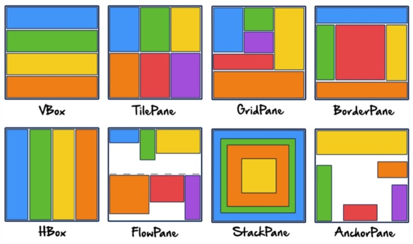

# Scene Graph

Tenim bàsicament dos tipus de grafs de nodes: Group i Region.

## Group

```java
Group root = new Group();
ObservableList list = root.getChildren(); 
list.add(nodeObject1);

Scene scene = new Scene(root);
primaryStage.setScene(scene); 
```

## Region

```java
StackPane pane = new StackPane();       
ObservableList list = pane.getChildren(); 
list.add(nodeObject1);

Scene scene = new Scene(root);
primaryStage.setScene(scene); 
```

## Layouts

<figure><figcaption></figcaption></figure>
