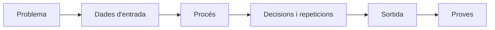

# Page 1

Programar no és només escriure codi. Abans de començar a escriure instruccions en Java, cal entendre bé el problema, decidir quines dades intervenen, quines decisions s'han de prendre i quins passos s'han de repetir.

Aquest apartat serveix per treballar la manera de pensar pròpia de la programació: **analitzar, descompondre, ordenar, provar i justificar una solució**.


Amb l'ajuda de les eines d'intel·ligència artificial podem generar codi molt ràpidament, però això no substitueix la capacitat d'entendre el problema i valorar si la solució és correcta. Un bon programador o programadora ha de saber explicar què fa el codi, per què ho fa i com comprovar que funciona.


### Pensar abans de programar

Davant d'un problema, és convenient seguir sempre un procés semblant:

1. **Entendre el problema**: què es demana exactament?
2. **Identificar les dades d'entrada**: quina informació necessitem?
3. **Determinar la sortida esperada**: quin resultat volem obtenir?
4. **Dividir el problema en parts més petites**.
5. **Ordenar els passos** que cal seguir.
6. **Detectar decisions**: en quins punts cal triar entre diferents opcions?
7. **Detectar repeticions**: quins passos s'hauran de fer més d'una vegada?
8. **Provar la solució** amb exemples concrets.



### Una plantilla per resoldre reptes

Abans d'escriure codi, podem omplir aquesta fitxa:

| Pregunta                                    | Resposta |
| ------------------------------------------- | -------- |
| Què ha de fer el programa?                  |          |
| Quines dades necessito?                     |          |
| Quin resultat he d'obtenir?                 |          |
| Quins passos principals he de seguir?       |          |
| Hi ha alguna decisió?                       |          |
| Hi ha alguna repetició?                     |          |
| Quins casos de prova puc fer servir?        |          |
| Quins errors o casos límit poden aparèixer? |          |

Aquesta plantilla ajuda a separar dues dificultats diferents: **saber resoldre el problema** i **saber escriure la solució en Java**.

### Descomposició

La descomposició consisteix a dividir un problema gran en problemes més petits i més fàcils de resoldre.

Per exemple, si volem fer un programa que calculi el preu final d'una compra, podem dividir el problema així:

1. Llegir el preu del producte.
2. Llegir la quantitat.
3. Calcular el subtotal.
4. Comprovar si cal aplicar un descompte.
5. Calcular el total final.
6. Mostrar el resultat.


Una bona pregunta és: _si hagués d'explicar aquest problema a una altra persona, quines parts li explicaria primer?_


### Abstracció

L'abstracció consisteix a quedar-nos amb la informació important i deixar de banda els detalls que no afecten la solució.

Per exemple, si volem calcular si una persona pot entrar a una activitat per edat, probablement només ens interessa:

* l'edat de la persona;
* l'edat mínima requerida;
* si compleix o no la condició.

No ens cal saber el nom, el color de la samarreta o el municipi on viu, si aquestes dades no intervenen en la decisió.

### Dades que canvien i dades que es calculen

Quan pensem un algorisme, cal diferenciar entre:

* **Dades d'entrada**: les rep el programa.
* **Dades internes**: les necessita per anar treballant.
* **Dades de sortida**: són el resultat final.

Exemple: volem calcular la mitjana de tres notes.

| Tipus de dada | Exemple                   |
| ------------- | ------------------------- |
| Entrada       | `nota1`, `nota2`, `nota3` |
| Interna       | `suma`                    |
| Sortida       | `mitjana`                 |

Abans d'entrar a la sintaxi de Java, ja podem començar a veure que els programes necessiten **guardar informació** i **transformar-la**.

### Decisions

Molts programes han de prendre decisions. Una decisió apareix quan el programa ha d'actuar d'una manera o d'una altra segons una condició.

Exemple:

```
SI edat >= 18 LLAVORS
    Escriure "Pot accedir"
SINÓ
    Escriure "No pot accedir"
FI SI
```

La part important no és només saber escriure la condició, sinó entendre:

* què s'està comprovant;
* quins valors fan que la condició sigui certa;
* què ha de passar si és falsa.

### Repeticions

Una repetició apareix quan cal fer el mateix procés diverses vegades.

Exemple: volem llegir les notes de 20 alumnes i comptar quants han aprovat.

```
aprovats := 0

PER alumne := 1 FINS 20 FER
    Llegir nota
    SI nota >= 5 LLAVORS
        aprovats := aprovats + 1
    FI SI
FI PER

Escriure aprovats
```

Abans de decidir quin tipus de bucle utilitzarem, ens hem de preguntar:

* sabem quantes vegades s'ha de repetir?
* repetim fins que passi alguna cosa?
* hi ha una condició que pot fer acabar el procés?

### Traça manual

Fer una traça vol dir simular l'execució d'un algorisme pas a pas, anotant com canvien les dades.

Per exemple:

```
suma := 0
PER i := 1 FINS 3 FER
    suma := suma + i
FI PER
```

| Pas      | `i` | `suma` |
| -------- | --: | -----: |
| Inici    |   - |      0 |
| 1a volta |   1 |      1 |
| 2a volta |   2 |      3 |
| 3a volta |   3 |      6 |

Fer traces és útil per entendre programes, detectar errors i comprovar si una solució fa realment el que esperàvem.

### Casos de prova

Un programa no es pot donar per bo només perquè funciona una vegada. Cal provar-lo amb diferents casos.

| Tipus de prova | Exemple                                 |
| -------------- | --------------------------------------- |
| Cas normal     | dades habituals                         |
| Cas límit      | el valor mínim o màxim permès           |
| Cas erroni     | dades incorrectes o buides              |
| Cas especial   | una situació poc freqüent però possible |

Exemple: si fem un programa que calcula el preu d'una entrada segons l'edat, hauríem de provar edats com 0, 17, 18, 64, 65 i també valors incorrectes com -1.

### Detectar errors abans de programar

Molts errors es poden detectar abans d'escriure codi si ens fem bones preguntes:

* Què passa si l'usuari escriu un valor negatiu?
* Què passa si no hi ha cap dada?
* Què passa si dues opcions són iguals?
* Què passa si el resultat ha de tenir decimals?
* Què passa si la repetició no acaba mai?
* ...

Aquestes preguntes ens ajuden a fer programes més robustos.

### Treballar amb IA sense deixar de pensar

La IA pot ser una eina útil per aprendre programació, però no ha de substituir el raonament propi.

Podem utilitzar-la per:

* demanar exemples semblants;
* demanar explicacions d'un fragment de codi;
* generar casos de prova;
* buscar possibles errors;
* comparar dues solucions.

Però sempre cal comprovar:

* si la solució resol exactament el problema demanat;
* si tracta els casos límit;
* si entenem cada part del codi;
* si podem explicar-lo amb les nostres paraules.


Si no pots explicar el codi, encara no és realment una solució teva.


***

> **Pensar bé el problema no és una pèrdua de temps**. És la manera de **reduir errors**, **escriure millor codi** i poder **justificar les nostres decisions** com a desenvolupadors.
