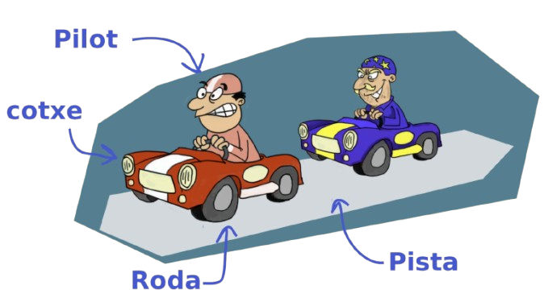

# Programació Orientada a Objectes

La **Programació Orientada a Objectes (P.O.O.)** és un paradigma de programació que posa el focus en els **objectes** i les seves **capacitats** en lloc de la lògica i les accions. Divideix els programes en objectes que interactuen entre si per processar dades.&#x20;

Aquest paradigma o metodologia, es basa a **identificar els objectes** que componen el problema i **reflexionar** sobre quins són els **necessaris** per resoldre el problema.

<figure><figcaption>
Imatge de Xevi Sala
</figcaption></figure>

Es tracta de posar el focus en **què s'ha de fer** i **no amb com s'ha de fer.**

<figure><figcaption>
Imatge de Xevi Sala
</figcaption></figure>

### Objectiu de la P.O.O.:

* Facilitar el **disseny** i el **manteniment** del codi. Incrementant la capacitat d'afegir noves funcionalitats sense modificar el codi existent.
* Millorar la **reutilització** del codi mitjançant la creació de components modulars i independents.
* Representar problemes complexos mitjançant una estructura clara, basada en **models del món real**.
* Millorar la **robustesa** del codi, **encapsulant** les dades i la implementació de les funcionalitats.

***

### Resolució de problemes mitjançant l'abstracció

L'abstracció consisteix a simplificar un problema destacant només els detalls més importants d'una entitat. Extreure l'essència d'aquella entitat i definir-ne les propietats que la representen.

Posem per cas que volem fer un programa que simuli una cursa de camells. Els camells reals tenen moltes característiques i capacitats.

<figure><figcaption>
Cursa de camells
</figcaption></figure>

* **Característiques:** Pes, edat, color, pelatge, nom, raça, velocitat...
* **Capacitats:** Menjar, beure, reproduir-se, defecar, orinar, caminar, córrer, aixecar-se, seure...


Penseu que per implementar el nostre joc de la cursa de camells necessitem que els nostres camells tinguin totes aquestes característiques?&#x20;


Aquí és on hem d'aplicar l'abstracció. Quines són les característiques i accions que han de tenir els nostres camells?

### Avantatges de la Programació Orientada a Objectes

1. **Reusabilitat:**
   * Mitjançant herència i polimorfisme, es poden utilitzar components ja desenvolupats sense necessitat de començar des de zero.
2. **Mantenibilitat:**
   * Les classes encapsulades i ben estructurades faciliten la modificació i depuració del codi.
3. **Modularitat:**
   * Divideix el programa en mòduls lògics (objectes i classes), fet que en facilita la comprensió i col·laboració.
4. **Seguretat:**
   * L'encapsulació protegeix les dades crítiques limitant-ne l'accés.
5. **Escalabilitat:**
   * És fàcil afegir noves funcionalitats al programa ampliant classes o creant-ne de noves.
6. **Modelatge Realista:**
   * Permet representar entitats del món real d'una manera més intuïtiva i clara.
