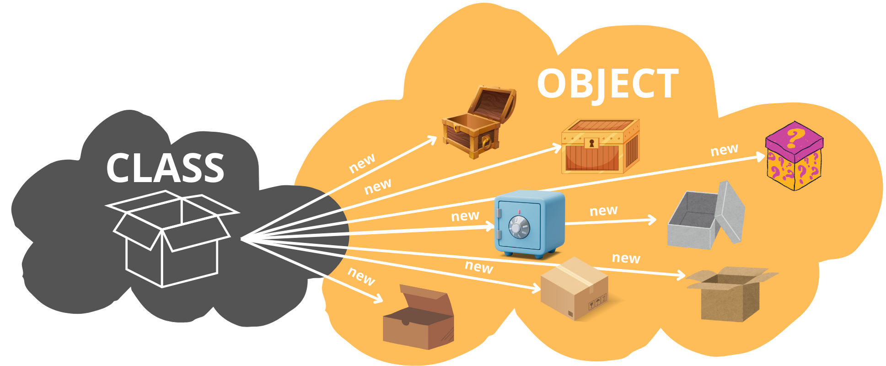

# Classes i Objectes

### Classe

Una **classe** és una plantilla que defineix les **propietats (atributs)** i els **comportaments (mètodes)** d'un objecte. La classe simplement és una descripció de les **característiques** i **capacitats** que pot tenir una entitat.

<figure><figcaption></figcaption></figure>

### Objecte

Un **objecte** és una instància d'una classe. Cada objecte creat a partir d'una mateixa classe comparteix el comportament definit, però pot tenir valors propis per als atributs.

<figure><figcaption></figcaption></figure>

***

### Classes o objectes? :thinking:&#x20;

Un **objecte** és la representació de qualsevol element en un sistema informàtic. En canvi, una **classe** és el motlle o plantilla que ens permet crear objectes d'un tipus concret.&#x20;

<figure><figcaption></figcaption></figure>

Podem definir la classe Fulla, Eina, FiguraGeomètrica... però aquesta classe no serà un element com a tal amb unes característiques concretes, sinó la plantilla que ens permetrà crear-ne molts de diferents.\
\
Podem veure fàcilment, que de fulles n'hi ha de molts tipus i cada una tindrà les seves característiques. La classe Fulla el que ens determina és els camps que identificaran una fulla i les accions que podrà fer aquesta.

**Les classes ens permeten crear objectes del tipus que defineixen amb unes propietats o estats concrets**.&#x20;

<figure><figcaption></figcaption></figure>

A l'exemple anterior podem veure el concepte de la **classe Caixa** i moltes possibles **instàncies de la classe (objectes)** que representin una Caixa però amb diferents propietats o estats.

Si ens imaginem que la nostra aplicació ha de guardar informació de clients, ens hem d'imaginar la classe **Client** com la definició dels camps que s'haurà d'emplenar de cada **Client**.

<figure><figcaption></figcaption></figure>

Cada un dels clients que es creïn dins de la nostra aplicació, podem imaginar-lo com un Client concret amb unes dades i característiques concretes.

***


