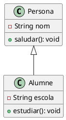

# Herència

L’**herència** és el mecanisme que permet a una classe (subclasse) **heretar** atributs i mètodes d’una altra classe (superclasse). Això permet reutilitzar codi i definir relacions de jerarquia.

<figure><figcaption></figcaption></figure>

**Com es defineix en Java?**\
S’utilitza la paraula clau `extends` per indicar que una classe hereta d’una altra.&#x20;


<figure><figcaption></figcaption></figure>

## Teoria d'Herència en la Programació Orientada a Objectes (POO)

### 💡 Introducció a l'Herència

L'herència és un mecanisme essencial en la programació orientada a objectes (POO) que permet que una classe (subclasse) reutilitzi i ampliï les propietats i comportaments d'una altra classe (superclasse). Fomenta la reutilització de codi i facilita la creació de jerarquies de classes organitzades.

#### 📝 Per què serveix l'herència?

* **Reutilització de codi:** Les subclasses aprofiten mètodes i atributs de la superclasse.
* **Extensió de funcionalitats:** Les subclasses poden sobreescriure comportaments.
* **Polimorfisme:** Una mateixa operació es comporta diferent segons la classe.
* **Organització jeràrquica:** Facilita la comprensió mitjançant jerarquies.

> 🟡 **Exemple:** Una classe _Persona_ amb _nom_ i _edat_, i subclasses _Alumne_ i _Professor_ amb mètodes propis.

### 📌 Conceptes Clau

* **Superclasse:** Classe base que aporta atributs i mètodes.
* **Subclasse:** Classe derivada que hereta i pot ampliar comportaments.
* **Visibilitat:** Control d'accés (public, private, protected).

### 💻 Exemples d'ús a Java

#### Exemple 1: Herència bàsica

```java
class Persona {
    String nom;
    public void saludar() {
        System.out.println("Hola, sóc una persona.");
    }
}
class Alumne extends Persona {
    public void estudiar() {
        System.out.println("Estic estudiant.");
    }
}
```

#### Exemple 2: Ús de `super`

```java
class Persona {
    String nom;
    Persona(String nom) {
        this.nom = nom;
    }
}
class Alumne extends Persona {
    String escola;
    Alumne(String nom, String escola) {
        super(nom);
        this.escola = escola;
    }
}
```

> ℹ️ **Nota:** `super` crida el constructor de la superclasse.

### 📊 Esquema UML per Lucidchart



> 🟢 **Nota:** Aquest esquema es pot importar directament a Lucidchart per a la seva visualització.

### 🚧 Problemes Comuns

* ⚠️ **Pèrdua d'identitat:** Una subclasse tractada com a superclasse perd funcionalitats específiques.
* ⚠️ **Problema del diamant:** Java ho resol amb interfícies en comptes d'herència múltiple.

### ✅ Conclusió

L'herència és essencial per a un bon disseny POO. Usada amb cura i combinada amb polimorfisme i interfícies, permet construir aplicacions escalables i reutilitzables.

***

#### 🟢 _Documentació apta per GitBook i Lucidchart. Si necessites més exemples o detalls, fes-m'ho saber!_ 🚀
