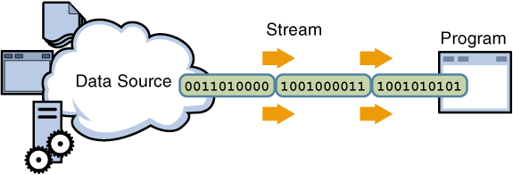

# Tractament bàsic de dades

Normalment, les aplicacions que fan servir fitxers no estan centrades en la gestió del sistema de fitxers ni tampoc de navegar per ell.&#x20;

L’objectiu principal d’usar fitxers és **poder emmagatzemar-hi dades o recuperar les que hi ha guardades**.&#x20;

<figure><figcaption></figcaption></figure>

Per tractar les dades d'un fitxer, és imprescindible **saber com s'organitzen** dins d'aquest. Més enllà del format o codificació del fitxer d'on volem llegir les dades, també és imprescindible saber la manera com està organitzada.

|  |  |  |
| ------------------------------------------------------------------------------ | ------------------------------------------------------------------------------ | ------------------------------------------------------------------------------ |

Podem emmagatzemar qualsevol mena de dades, el més important és saber que aquests valors s'hi guarden de manera seqüencial, un rere l'altre. Per tant, **la manera més habitual de tractar un fitxer és seqüencialment**.

Per treballar amb fitxers de manera seqüencial, és freqüent utilitzar operacions com ara:

* **Llegir**: Per accedir a les dades emmagatzemades als fitxers de manera ordenada.
* **Escriure**: Per guardar dades noves al final d’un fitxer o sobreescriure'n contingut existent.
* **Tancar**: Per alliberar els recursos assignats al fitxer després de realitzar operacions de lectura o escriptura.
