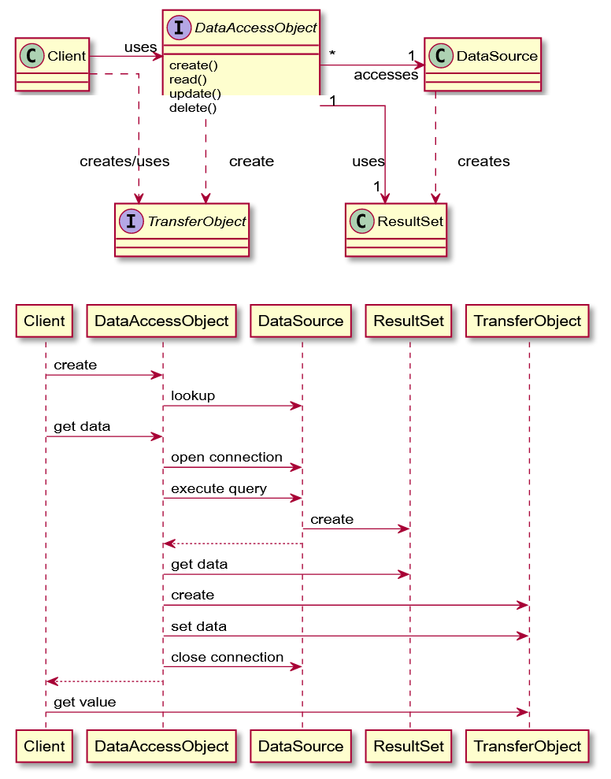

# Patrons de disseny

## Model de capes d'una aplicació

Les capes d'una aplicació que necessita persistència podrien establir-se de la següent manera:

* **Presentació**: la part que s'encarrega de la interacció amb l'usuari. En el patró MVC, inclouria la vista i el controlador.
* **Domini**: lògica de negoci, relacionant les dades amb el seu comportament.
* **Dades**: comunicació amb altres sistemes que fan tasques necessàries per a la nostra aplicació. Per exemple, la base de dades.

On s'executa cada capa?

* **Presentació**: per a clients rics, al client. Per a B2C, al servidor (HTML).
* **Domini**: al servidor, més fàcil manteniment. Al client, si és desconnectat. Si cal dividir-la, cal aïllar les dues parts.
* **Dades**: al servidor, excepte si és un client desconnectat, llavors cal gestionar sincronitzacions.

## Patrons del model

Dos estils d'implementació:

* Senzill: similar al disseny de DB, un objecte de domini per taula. Ús del patró [**Active record**](https://en.wikipedia.org/wiki/Active\_record\_pattern) (objecte que embolica una fila d'una taula, encapsula l'accés i afegeix lògica de domini en aquestes dades).
* Ric: disseny diferent de la DB, amb herència, estratègies i altres patrons. Ús del patró [**Data Mapper**](https://en.wikipedia.org/wiki/Data\_mapper\_pattern) (una capa de Mappers que mou les dades entre objectes i una base de dades mantenint-les independents les unes de les altres i del mateix mapper).

## Patrons de la base de dades relacional

Cal fer un mapeig entre objectes i el món relacional perquè quan programem bases de dades relacionals, el seu model és diferent del dels objectes en memòria. Aquesta és una de les principals dificultats quan treballem amb els dos mons.

El patró general es diu **Gateway**: un objecte que encapsula l'accés a un recurs o sistema extern. Hi ha dues possibles implementacions:

* **Row data gateway**: una instància del gateway per cada registre que retorna una consulta.
* **Table data gateway** (o **DAO**): una instància gestiona tots els registres en una taula. Els registres es retornen a Record Sets.

## Patró DAO (Data Access Object)

A continuació es pot veure el diagrama de classes del patró DAO i un exemple de seqüència.

<figure><figcaption><p>Diagràmes del patró DAO</p></figcaption></figure>

Aquest patró utilitza un objecte de transferència, `TransferObject`, per intercanviar informació entre el client i la base de dades. Aquest objecte és una estructura de dades sense lògica de processament i habitualment immutable.

Cada objecte DAO efectua operacions sobre una taula: creació, lectura, modificació i esborrat.

### Disseny d'un DAO

Aquests són els consells a l'hora de dissenyar un DAO:

* És convenient utilitzar sempre una interfície per definir un DAO, per tal d'aïllar millor el domini de les dades.
* Els mètodes públics, si utilitzen altres privats per a executar l'operació, han de compartir la mateixa `Connection`.
* No retornar mai objectes associats a la capa de base de dades, per exemple, evitant fer visible els `ResultSet` o els `SQLException`.
* Si una excepció SQL no és recuperable, utilitzeu una `RuntimeException` embolcall d'aquesta.
* No utilitzar camps al marge del `DataSource`, ja que un DAO hauria de dissenyar-se sense estat per poder ser thread-safe.

## Estratègies DAO

### Objecte de transferència

L'objecte de transferència es pot utilitzar com es pot veure al següent exemple.

```java
// suposem que a resultSet hi ha un registre d'una cerca
Persona persona = new Persona(); // transfer object
persona.setId(resultSet.getInt("id"));
persona.setName(resultSet.getString("name"));
...
return persona;
```

Els objectes de transferència poden implementar-se de diferents maneres, en particular, poden ser **mutables** o **immutables**. La preferència general seria que fossin immutables al client que els utilitza, malgrat que això pot significar complicar-los pel que fa a la seva programació.

* Com a l'exemple, amb getters i setters. La més convencional.
* Amb una interfície immutable, encara que la seva implementació sigui mutable. La més correcta.
* Amb camps públics i sense getters ni setters. La més senzilla.
* Alternativament, es pot utilitzar un Map\<String, Object>, similar al concepte _schemaless_. No requereix classes, però es perd la validació en temps de compilació. Relacionat amb els JSON.

### Col·lecció d'objectes de transferència

Com ja s'ha comentat, és millor no exposar objectes associats a la capa de dades al client. Per exemple, evitar fer visible els ResultSet. Així encapsulem i evitem dependències i haver de gestionar excepcions de tipus SQLException. En aquesta estratègia el DAO crea una sentència SQL i executa una consulta per obtenir un ResultSet. Llavors el DAO processa el ResultSet per recuperar tantes files de resultats coincidents com ho sol·liciti el client que fa la crida. Per a cada fila, el DAO crea un objecte de transferència i l’afegeix a una col·lecció que es retorna al client.

```java
List<Persona> persones = new ArrayList<>();
while (resultSet.next()) {
    Persona persona = new Persona(); // transfer object
    persona.setId(resultSet.getInt("id"));
    persona.setName(resultSet.getString("name"));
    persones.add(to);
}
return persones;
```

### Factoria de DAO

Quan tenim diversos DAO que cal crear per diferents taules, un patró habitual és la factoria de DAO.

```java
public class DAOFactory {
    private static DAOFactory instance;
    private DAOFactory() {
        // init ConnectionFactory
    }
    public static DAOFactory getInstance() {
        if (instance == null)
            instance = new DAOFactory();
        return instance;
    }
    public CustomerDAO getCustomerDAO() {
        // implementar-ho
    }
    public AccountDAO getAccountDAO() {
        // implementar-ho
    }
    public OrderDAO getOrderDAO() {
        // implementar-ho
    }
}
```

## Control de concurrència

Quan tractem de llegir i modificar dades, podríem afrontar alguns dilemes sobre la integritat i la validesa de la informació. Aquests dilemes sorgeixen a causa de les operacions de bases de dades xocant entre elles; per exemple, dues operacions d’escriptura o una operació de lectura i escriptura que col·lideixen.

Les estratègies per resoldre aquesta situació poden ser:

* **Bloqueig pessimista**: s'espera una col·lisió, i llavors es fa un bloqueig dels recursos implicats. Cap altre client pot accedir-los fins que no es lliurin.
* **Bloqueig optimista**: la col·lisió és poc probable. Es deixa fer, i quan acaba el processament, es comprova si hi ha hagut un problema.
* **Bloqueig massa optimista**: no s'esperen col·lisions. Potser és un sistema monousuari.

Les transaccions dels SGBD resolen aquests problemes gràcies a la implementació de les característiques **ACID**. Primer, totes les sentències individuals que s'executen són atòmiques, és a dir, o bé s'executen o no ho fan, però mai provoquen problemes de consistència. Segon, podem estendre aquesta capacitat per a un conjunt de sentències mitjançant l'**ús de transaccions**.

Les estratègies de resolució de col·lisions poden ser:

* Rendir-se.
* Mostrar el problema, i deixar que decideixi l'usuari.
* Barrejar els canvis.
* Registrar el problema, i que ho resolgui algú altre més tard.
* Ignorar la col·lisió.

Tanmateix, les transaccions no sempre són la solució en l'àmbit de les aplicacions. Les lectures/escriptures de dades separades en el temps poden provocar contenció de dades. Per exemple, una transacció no pot esperar que un usuari modifiqui les dades després d'haver-les llegit en un formulari.

Els mecanismes del **bloqueig pessimista** s'implementen mitjançant ordres que permeten bloquejar registres de la base de dades. Es fa perquè hi ha alta contenció i el cost de bloquejar és menor que el de fer enrere una transacció.

En canvi, el **bloqueig optimista** s'implementa fent que hi hagi un error si hi ha hagut col·lisió, i llavors cal que l'usuari torni a fer l'operació. Pot implementar-se amb un control de timestamps, comptadors o versions d'un registre. La modificació dels registres actualitza aquests valors, i pot utilitzar-se com a condició per fer fallar una transacció. Aquest podria ser una possible transacció:

* **Inici**: guardar un timestamp/versió que marca l'inici de la transacció
* **Fer canvis**: llegir i intentar escriure a la base de dades
* **Validar**: veure si les dades modificades són les marcades inicialment
* **Confirmar/Desfer**: si no hi ha conflicte, fer els canvis; si hi ha, desfer-los.
